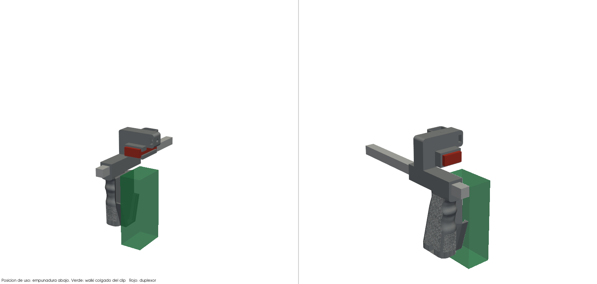
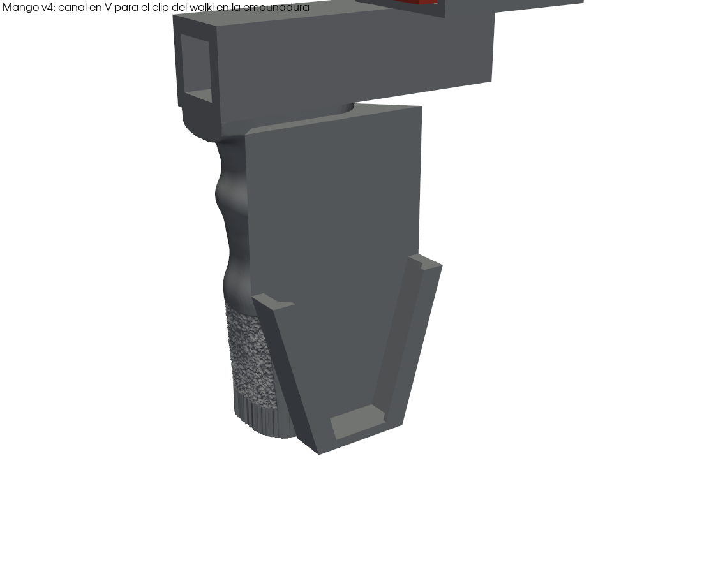

<p align="center">
  
</p>

# Mango SpaceQuad con trípode, soporte de walki por clip y duplexor

Mango imprimible en 3D para la antena de satélites **BIG SIGNAL SpaceQuad** (VHF/UHF, boom cuadrado de 15 mm).
Se puede llevar en la mano o montar en un trípode de fotografía. Lleva un **canal universal para el clip de cinturón del walki**
en la empuñadura y una funda para el duplexor.

<p align="center">
  
</p>

## Novedades de la v4

- **Canal universal para el clip del walki en la empuñadura**: sustituye a la lengüeta de la torre de la v3, que en la
  práctica no funcionaba. En planta es una **V**: ancha arriba (50 mm, junto al boom) y estrecha en la punta (24 mm, cerrada).
  La lengua del clip entra por arriba bajo dos labios en cola de milano y baja hasta que su ancho coincide con el del canal.
  Ahí se acuña con el propio peso del walki. Los labios hacen de cinturón: el muelle del clip los aprieta contra la espalda del walki.
  Vale para lenguas de **25 a 45 mm** de ancho y hasta **6 mm** de grosor.
- **Rosca del trípode al alcance de tornillos cortos**: la tuerca sigue a **1,2 mm** de la cara del culo, y la ranura
  admite ahora **dos tuercas apiladas**. Con un tornillo de 10 mm la rosca coge **8,8 mm** (con una sola tuerca, 5,9 mm).

<p align="center">
  
</p>

## Características

- **Encaja en el boom de la SpaceQuad**: túnel de 15,5 × 15,5 mm para el boom cuadrado de 15 mm (0,5 mm de holgura).
- **Rosca de trípode en el culo de la empuñadura**: una o dos tuercas 1/4"-20 embutidas en una base plana de 52 × 31 mm.
  La empuñadura queda hacia abajo y el boom horizontal, igual que al llevarla en la mano.
- **Canal del clip**: tramo con labios de 46 mm, de 50 a 24 mm de ancho, 7 mm de hueco bajo los labios
  y labios de 1,5 a 4,5 mm de grosor. Encima tiene una rampa de entrada de 45 mm sin labios.
- **Funda para el duplexor** VHF/UHF entre la torre y el boom: 16 × 32 mm por dentro, 48 mm de largo, abierta por los extremos.
- **Paramétrico**: todo se genera con scripts de Python (trimesh + manifold3d), así que las medidas se pueden adaptar.

## Contenido del repositorio

```
stl/    Piezas listas para imprimir (ya orientadas)
  mango_spacequad_v4.stl         Mango v4 (canal del clip + funda duplexor + base de trípode)
  mango_spacequad_tripode.stl    Mango v1 (se conserva: es la entrada de mango_v4.py)
src/    Scripts paramétricos que generan las piezas
docs/   Imágenes, montaje y lista de materiales
legacy/ Pinza del móvil (v1) y soporte GoPro con mordazas (v2), ya no se usan
```

## Materiales

Lista completa en [docs/MATERIALES.md](docs/MATERIALES.md). En resumen:

| Cantidad | Pieza |
|---|---|
| 2 | Tuercas hexagonales 1/4"-20 UNC (11,1 mm entre caras) para el trípode (opcional; con una basta si el tornillo es largo) |

El walki se sujeta con su propio clip de cinturón: no hace falta tornillería.

## Impresión

| Pieza | Material | Orientación | Soportes |
|---|---|---|---|
| Mango v4 | PETG o ASA (exterior, al sol) | La del STL | Sí, desde la cama (bajo la empuñadura y la torre). El canal del clip no los necesita |

0,2 mm de capa, 4 perímetros y 30–40 % de relleno. El canal queda arriba, con los labios a 45°, así que sale sin soportes.

## Montaje

Pasos detallados en [docs/MONTAJE.md](docs/MONTAJE.md).

1. Mete las tuercas 1/4"-20 por su ranura del culo de la empuñadura.
2. Pasa el boom de la SpaceQuad por el túnel del mango y mete el duplexor en su funda.
3. Engancha el walki: apoya la lengua del clip en la rampa, métela bajo los labios y deja que baje hasta que se acuñe.

## Compatibilidad del clip

| Dato | Valor |
|---|---|
| Ancho de la lengua del clip | de 25 a 45 mm (las más estrechas se acuñan más abajo) |
| Grosor de la lengua | hasta 6 mm |
| Abertura del clip | al menos 4,5 mm (grosor del labio junto a la pared) |

Medidas estimadas de lenguas de clip: Yaesu FT-60/65 (metálica) 25–28 mm; Baofeng UV-5R/UV-82 30–34 mm;
Quansheng UV-K5 33–35 mm; TYT MD-380 33–36 mm; Kenwood/Motorola profesionales 40–45 mm.
Las medidas se cambian en `src/mango_v4.py`.

## Regenerar las piezas

```bash
pip install -r src/requirements.txt
cd src
python mango_v4.py ../stl/mango_spacequad_tripode.stl ../stl/mango_spacequad_v4.stl
python verificar.py ../stl/mango_spacequad_v4.stl      # pieza estanca, canal, choques, voladizos y tuerca del trípode
python render_docs.py ../stl ../docs/img                # imágenes
```

`mango_v4.py` parte del STL v1 incluido en el repositorio. `build_mango.py` (v1) parte del **STL original del mango**,
que no está incluido (ver *Créditos*) y necesita además `cadquery`.
Las medidas se cambian en la sección `PARAMETROS` de cada script.

## Estado

Diseño verificado en el ordenador: pieza estanca, lenguas de 25 a 45 mm que se acuñan dentro del canal, un walki
de 62 × 40 × 130 mm sin tocar el mango y a 6,7 mm o más del duplexor, sin voladizos nuevos de más de 45°
y 0 mm³ añadidos sobre el duplexor respecto a la v1.
**Aún sin probar impresa**: si algún ajuste no encaja, se abre un issue o se toca el parámetro correspondiente.

## Créditos y licencia

- Mango original de la SpaceQuad: **[AUTOR ORIGINAL — completar con nombre y enlace]**.
  Este proyecto es una modificación de su diseño y respeta su licencia original.
- Modificaciones, soporte de walki y scripts: **Bricohams**.
- BIG SIGNAL y SpaceQuad son marcas de sus respectivos propietarios. Este proyecto no está afiliado a ellos.

Licencia: [CC BY-SA 4.0](LICENSE) para los modelos y la documentación. Los scripts de `src/` también se
publican bajo CC BY-SA 4.0. Si la licencia del diseño original es distinta, **manda la del original**.

73 y buenas pasadas.
