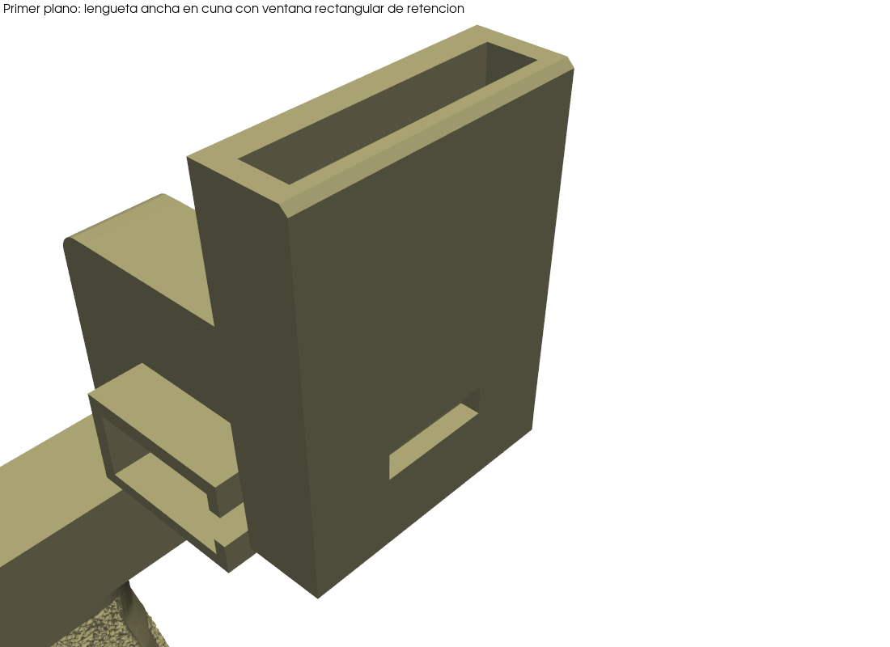

<p align="center">
  
</p>

# Mango SpaceQuad con trípode, soporte de walki por clip y duplexor

Mango imprimible en 3D para la antena de satélites **BIG SIGNAL SpaceQuad** (VHF/UHF, boom cuadrado de 15 mm).
Se puede llevar en la mano o montar en un trípode de fotografía. Lleva una **lengüeta ancha para el clip de cinturón del walki**
en la torre y una funda para el duplexor.

<p align="center">
  
</p>

## Novedades de esta revisión de la v3

Se vuelve a la v3 (lengüeta en la torre, la misma tuerca única de trípode a 1,2 mm de la cara) y **solo cambia el soporte del clip**:
una lengüeta elevada y ancha, en cuña, con laterales y una **ventana rectangular** de retención opcional.

- **Dimensiones estimadas** (no medidas, no verificadas con walkies reales): lenguas de clip de **25 a 45 mm** de ancho y hasta **6 mm** de grosor,
  70 mm de largo útil. Boca de 50 mm de ancho interior, que baja suavemente a 47 mm en el fondo, y 7 mm de holgura mínima.
  Un clip de 45 mm entra los 70 mm.
- Lo único verificado en una fuente pública es la separación de **26 mm entre tornillos** del clip Retevis/TYT MD-380 ([retevis.com](https://www.retevis.com/products/belt-clip-for-tyt-tytera-md-380-retevis-rt3-radio));
  no se conoce el grosor ni el ancho de su lengua.
- Los clips estrechos no se centran: quedan holgados lateralmente y se sujetan solo por el muelle del propio clip contra la lengüeta.
  La ventana no engancha todos los clips; es una ayuda opcional.
- Se conserva la v4 (canal en V sobre la empuñadura) en `legacy/mango_v4/`.

<p align="center">
  
</p>
<p align="center">
  
</p>
## Características

- **Encaja en el boom de la SpaceQuad**: túnel de 15,5 × 15,5 mm para el boom cuadrado de 15 mm (0,5 mm de holgura).
- **Rosca de trípode en el culo de la empuñadura**: **una** tuerca 1/4"-20 embutida en una base plana de 52 × 31 mm, a 1,2 mm de la cara.
  La ranura mide 5,9 mm (holgura de diseño); la rosca engranada está limitada por el grosor real de la tuerca (5,6 mm nominal), no por la cavidad.
  La empuñadura queda hacia abajo y el boom horizontal, igual que al llevarla en la mano.
- **Soporte del clip**: lengüeta elevada y ancha de 70 mm de largo útil y 4 mm de grosor, con paredes laterales en cuña,
  hueco de 7 a 10 mm para la lengua del clip, fondo cerrado y ventana rectangular de 22 × 6 mm.
- **Funda para el duplexor** VHF/UHF entre la torre y el boom: 16 × 32 mm por dentro, 48 mm de largo, abierta por los extremos.
- **Paramétrico**: todo se genera con scripts de Python (trimesh + manifold3d), así que las medidas se pueden adaptar.

## Contenido del repositorio

```
stl/    Piezas listas para imprimir (ya orientadas)
  mango_spacequad_v3.stl         Mango v3 revisado (soporte del clip + funda duplexor + base de trípode)
  mango_spacequad_tripode.stl    Mango v1 (se conserva sin cambios: es la entrada de mango_v3.py)
src/    Scripts paramétricos que generan las piezas
docs/   Imágenes, montaje y lista de materiales
legacy/ Pinza del móvil (v1), soporte GoPro (v2) y mango v4 (canal en V), ya no se usan
```

## Materiales

Lista completa en [docs/MATERIALES.md](docs/MATERIALES.md). En resumen:

| Cantidad | Pieza |
|---|---|
| 1 | Tuerca hexagonal 1/4"-20 UNC (11,1 mm entre caras) para el trípode (opcional) |

El walki se sujeta con su propio clip de cinturón: no hace falta tornillería.

## Impresión

| Pieza | Material | Orientación | Soportes |
|---|---|---|---|
| Mango v3 | PETG o ASA (exterior, al sol) | La del STL | Sí, desde la cama (bajo la empuñadura y la torre) y bajo la lengüeta del clip |

0,2 mm de capa, 4 perímetros y 30–40 % de relleno.

## Montaje

Pasos detallados en [docs/MONTAJE.md](docs/MONTAJE.md).

1. Mete la tuerca 1/4"-20 por su ranura del culo de la empuñadura.
2. Pasa el boom de la SpaceQuad por el túnel del mango y mete el duplexor en su funda.
3. Engancha el walki: baja la lengua del clip por la boca de la lengüeta, entre ella y la torre, y deja que el walki cuelgue por fuera.
## Compatibilidad del clip (estimada)

| Dato | Valor (estimación de diseño, no medida) |
|---|---|
| Ancho de la lengua del clip | de 25 a 45 mm; boca de 50 mm, fondo de 47 mm |
| Grosor de la lengua | hasta 6 mm (holgura mínima del canal 7 mm) |
| Largo útil | 70 mm; un clip de 45 × 6 mm entra los 70 mm |
| Clips estrechos | quedan holgados en el ancho; el muelle del clip los sujeta, sin centrado |
| Ventana de 22 × 6 mm | retención opcional; no engancha todos los clips |

Familias pensadas: clips de cinturón de Baofeng, Radtel, Anytone, Quansheng y Retevis RT3S (sin atornillar al mango).
**No se ha medido ninguno**; solo está verificada en [retevis.com](https://www.retevis.com/products/belt-clip-for-tyt-tytera-md-380-retevis-rt3-radio) la separación de 26 mm entre tornillos del clip del MD-380/RT3.
No se garantiza ajuste universal: comprueba el clip de tu walki. Las medidas se cambian en `src/mango_v3.py`.

## Regenerar las piezas

```bash
pip install -r src/requirements.txt
cd src
python mango_v3.py ../stl/mango_spacequad_tripode.stl ../stl/mango_spacequad_v3.stl
python verificar.py ../stl/mango_spacequad_v3.stl      # estanca, un solo sólido, localidad frente a la v3 original (git c77de14), clip, duplexor y tuerca
python render_docs.py ../stl ../docs/img                # imágenes
```

`mango_v3.py` parte del STL v1 incluido en el repositorio. `verificar.py` compara con la v3 original leyéndola de git (`c77de14`),
así que hay que ejecutarlo dentro del clon. `build_mango.py` (v1) parte del **STL original del mango**,
que no está incluido (ver *Créditos*) y necesita además `cadquery`.
Las medidas se cambian en la sección `PARAMETROS` de cada script.

## Estado

Comprobado en el ordenador: pieza estanca y de un solo sólido; la diferencia respecto a la v3 original queda dentro del soporte del clip
(ruido numérico ~0,00004 mm³ fuera); lenguas de 25 a 45 mm × 6 mm barridas desde la boca hasta 70 mm sin chocar con el mango
(sobre la pared y sobre la lengüeta); walki de 62 × 40 × 130 mm sin tocar mango ni duplexor; una sola tuerca en una ranura de 5,9 mm (rosca limitada por la tuerca real, 5,6 mm nominal).
**Ningún clip real ha sido medido ni probado, y el modelo no está probado impreso.**
## Créditos y licencia

- Mango original de la SpaceQuad: **[AUTOR ORIGINAL — completar con nombre y enlace]**.
  Este proyecto es una modificación de su diseño y respeta su licencia original.
- Modificaciones, soporte de walki y scripts: **Bricohams**.
- BIG SIGNAL y SpaceQuad son marcas de sus respectivos propietarios. Este proyecto no está afiliado a ellos.

Licencia: [CC BY-SA 4.0](LICENSE) para los modelos y la documentación. Los scripts de `src/` también se
publican bajo CC BY-SA 4.0. Si la licencia del diseño original es distinta, **manda la del original**.

73 y buenas pasadas.
